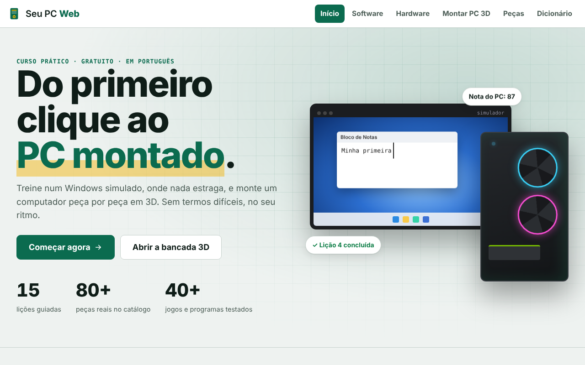

# Seu PC Web

Plataforma educativa para aprender informática do zero. Tem duas trilhas: um Windows simulado, onde a pessoa pratica sem medo de estragar nada, e uma bancada 3D para montar um computador peça por peça e descobrir quais jogos e programas ele roda.

**[Acessar o site](https://olucas-passos.github.io/seu-pc-web/)**



## Funcionalidades

**Trilha de software**
- Windows simulado com área de trabalho, janelas, explorador de arquivos, navegador, Bloco de Notas, Paint, calculadora e configurações
- 15 lições guiadas com um tutor que confere cada passo
- Conteúdo sobre segurança na internet e golpes comuns

**Trilha de hardware**
- Montagem de PC em 3D: encaixar processador, memória, placa de vídeo, parafusos e cabos
- Catálogo com mais de 80 peças reais e verificação de compatibilidade (soquete, tipo de memória, tamanho do gabinete, potência da fonte)
- Pontuação de desempenho e estimativa de FPS em mais de 40 jogos e programas
- PCs prontos de exemplo e editor de peças personalizadas
- Dicionário de termos técnicos explicados em linguagem simples

## Tecnologias

- HTML, CSS e JavaScript puro com ES Modules, sem frameworks
- [Three.js](https://threejs.org/) para a bancada 3D
- Roteamento por hash e progresso salvo no navegador (localStorage)
- Layout responsivo para desktop e celular

## Estrutura

```
css/        estilos do site, do Windows simulado e da bancada
js/pages/   páginas do site (início, software, hardware, peças, dicionário)
js/win/     Windows simulado: sistema de janelas, arquivos, aplicativos e lições
js/hw/      bancada 3D: catálogo, modelos, montagem, pontuação e resultados
```

## Como executar

```bash
git clone https://github.com/oLucas-Passos/seu-pc-web.git
cd seu-pc-web
npx serve .
```

Depois acesse `http://localhost:3000`. Os ES Modules precisam de um servidor local; abrir o `index.html` direto pelo arquivo não funciona.

## Autor

Lucas Passos · [GitHub](https://github.com/oLucas-Passos)
